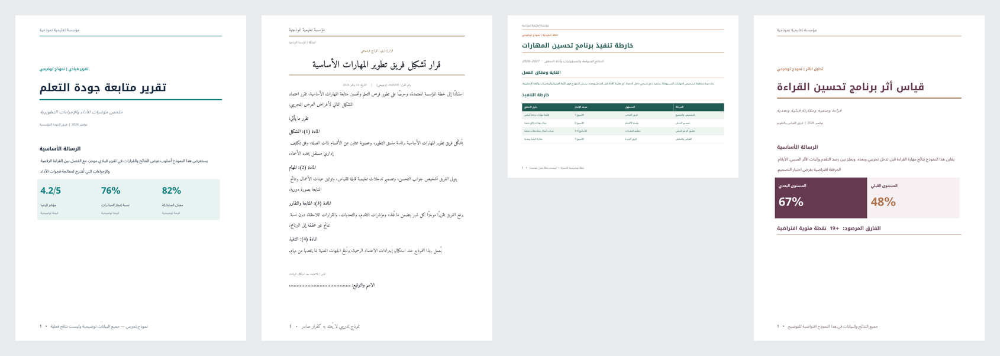

# استوديو تصميم ملفات Word العربية

**مهارة مخصصة لـ Claude لتصميم ملفات Word عربية احترافية وقابلة للتحرير، وفق نوع المستند لا وفق قالب واحد مكرر.**

الإصدار **1.1** يتضمن أربعة أنماط جاهزة للاختبار: تقرير قيادي، قرار إداري، خطة تنفيذية، وتقرير أثر. لكل نوع تكوين مستقل وطريقة مختلفة للعناوين والجداول وتوزيع المحتوى.

## لماذا أنشأنا هذه المهارة؟

المشكلة الأساسية ليست إنشاء Word؛ بل أن يختار المساعد نمطًا بصريًا واحدًا لكل الملفات. تحل المهارة ذلك عبر تصنيف المستند أولًا، ثم اختيار نمط مناسب، وإنشاء عناصر قابلة للتحرير داخل Word، وفحص اتجاه العربية وصفحات المستند قبل التسليم.

## الأنماط الأربعة

1. **التقرير القيادي:** A4 عمودي، غلاف افتتاحي، عرض المؤشرات وقرارات المتابعة، ألوان كحلية وفيروزية.
2. **القرار الإداري:** A4 عمودي، خط Amiri، مواد قرار وتوقيع، طابع رسمي متزن دون بطاقات زخرفية.
3. **الخطة التنفيذية:** A4 أفقي، جداول المسؤوليات والمواعيد وأدلة التحقق، أخضر مع لمسة نحاسية.
4. **تقرير الأثر:** A4 عمودي، مقارنة قبلية/بعدية، تفريق بين التحسن الملحوظ والأثر السببي، ألوان عنابية ونحاسية.



## التشغيل محليًا

يتطلب Python وملحقاته. يتطلب فحص الصفحات وجود LibreOffice مثبتًا على الجهاز.

```bash
pip install -r requirements.txt
python scripts/build.py examples/briefs/strategic_plan.json --out output/plan.docx
python scripts/audit_docx.py output/plan.docx --type strategic_plan
python scripts/render.py output/plan.docx --out-dir output/plan-preview
pytest -q
```

يُعدّل المستخدم محتوى الوثيقة داخل ملف JSON مع اختيار `document_type`، ويمكن ضبط الألوان والخطوط من حقل `brand`. توجد أمثلة جاهزة داخل `examples/briefs/` ودليل حقول البيانات داخل `references/brief-schema.md`.

## التثبيت في Claude

- **Claude Code:** ضع المجلد الذي يحتوي `SKILL.md` داخل `.claude/skills/arabic-word-design-studio/`.
- **Claude.ai:** استخدم ملف ZIP الخاص بالمهارة في واجهة إضافة المهارات إن كانت متاحة للحساب.

### معايير مهمة

- ملفات DOCX وجداولها ونصوصها قابلة للتحرير؛ ليست صورًا للصفحات.
- ضبط فعلي لخصائص RTL داخل Word، لا مجرد محاذاة لليمين.
- أمثلة المشروع جميعها **توضيحية** ولا تمثل نتائج فعلية لأي مدرسة أو جهة.
- نجاح الفحص البرمجي لا يغني عن مشاهدة كل صفحة بعد التصيير.
- لا توزَّع ملفات الخطوط ضمن المشروع؛ قد يختلف الترقيم والتوزيع إذا لم تتوفر الخطوط في جهاز المستفيد.

**حدود الإصدار الأول:** إنشاء وثائق جديدة من JSON فقط. لم يُضف بعد تحرير ملفات Word الموجودة مع الحفاظ التام على تنسيقها، أو مخططات Word الأصلية، أو فهرس تلقائي، أو تعقب التغييرات. ستعالج الإصدارات التالية هذه الإمكانيات.

ترخيص المشروع: MIT. تفاصيل الهيكل والمراجع التقنية في [دليل المعمارية](references/architecture.md).


## تحسينات التنسيق في v1.1

بعد مراجعة التصميم الفعلي أُصلحت ست مشكلات: بادئة التعداد أصبحت من **اليمين** مع إزاحة معلقة، وبادئات نصوص الجداول أصبحت **صفرًا**، وأضيفت هوامش داخلية متوافقة مع Word/LibreOffice، ووُحدت مسافات الفقرات داخل الخلايا، وأُصلح انعكاس نطاقات السنوات مثل **2026–2027**، واستُبدلت الفقرات الفارغة بعد الجداول بمسافات مضبوطة. أُضيفت فحوصات تمنع عودة هذه الأخطاء ضمن `tests/test_layout_regression.py`، ويقدّم `scripts/audit_docx.py` تقريرًا عن الخلايا والتعدادات.

القيم التقنية المعيارية مشروحة في [قواعد البادئات والهوامش](references/layout-spacing-rules.md). الفحص البنيوي لا يغني عن فحص كل صفحة بصريًا.
