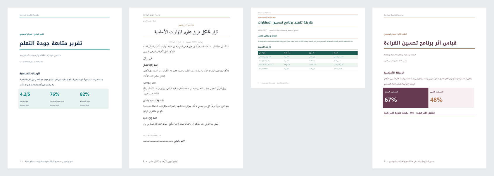

# Arabic Word Design Studio

**An open-source Claude-compatible skill for designing professional, editable, right-to-left Arabic Word documents.**

[الشرح بالعربية](README.ar.md) · [Skill instructions](SKILL.md) · [Examples](examples/briefs/) · [Quality rubric](references/quality-gates.md)

> **Version 1.0 — first tested release.** Four differentiated document presets, native Word typography and tables, OOXML RTL checks, and rendered-page review. Designed for *different document purposes*, not one generic visual template.

## What it does

| Genre | Layout | Default face | Content priorities |
| --- | --- | --- | --- |
| Executive report | A4 portrait + intro cover | Noto Kufi Arabic / Noto Sans Arabic | KPIs, synthesis, decisions |
| Official decision | A4 portrait, one-column official letter | Amiri | Articles, reference, signature |
| Strategic plan | A4 landscape | Noto Kufi Arabic / Noto Sans Arabic | Roadmap, owners, evidence |
| Impact report | A4 portrait + analytical cover | Noto Kufi Arabic / Noto Sans Arabic | Before/after, limitations, next steps |

- Real Heading paragraph styles, editable tables, header/footer and page number fields.
- Bidirectional paragraphs, complex-script run fonts, RTL table visual ordering and repeating table headings.
- Reproducible JSON brief with optional custom brand colors and fonts.
- Structural DOCX audit plus LibreOffice/PyMuPDF render-to-PNG QA workflow.
- Four **explicitly fictional** Arabic examples; no template data is asserted as factual.

## Preview



## Quick start

**Prerequisites:** Python 3.10+, and LibreOffice for rendering. The generator can build DOCX without LibreOffice; visual QA cannot.

```bash
python -m pip install -r requirements.txt
python scripts/build.py examples/briefs/executive_report.json --out output/my-report.docx
python scripts/audit_docx.py output/my-report.docx --type executive_report
python scripts/render.py output/my-report.docx --out-dir output/preview
```

Customizing your organization, content and branding is done by editing the input JSON. For example:

```json
{
  "document_type": "executive_report",
  "title": "تقرير أداء",
  "organization": "المؤسسة النموذجية",
  "brand": { "primary": "20324B", "accent": "178F79", "heading_font": "Noto Kufi Arabic" },
  "sections": [
    { "heading": "الملخص", "paragraphs": ["اكتب هنا بياناتك الحقيقية أو النص المقدم من المستخدم."] }
  ]
}
```

**Testing**:

```bash
pytest -q
```

## Install as a Claude skill

- **Claude.ai:** package the skill folder as a ZIP (provided in release bundles); upload through the product's supported skill management interface where available.
- **Claude Code:** place this directory in `.claude/skills/arabic-word-design-studio/` (or the user's supported skills directory). Claude reads the root `SKILL.md` and can reference files relative to it.

> Skills provide instructions and local scripts. Availability of file creation, Python execution or browser/LibreOffice rendering depends on your Claude environment. A skill does not bypass unavailable tools.

## Limitations

This first release generates **new DOCX documents from structured JSON**. It does not yet faithfully restyle arbitrary imported Word files, provide live Word charts/TOC/footnotes, handle tracked changes, or fully evaluate aesthetic quality without human review. Exported fonts are references; no proprietary or font files are distributed. Differences in installed fonts can change pagination across systems.

## Repo layout

```text
arabic-word-design-studio/
├── SKILL.md                     # The Claude skill
├── arabic_word_studio/          # Python composition and OOXML audit
├── examples/briefs/            # Four demonstration inputs
├── examples/output/            # Four generated editable DOCX examples
├── scripts/                    # Build / inspect / render CLIs
├── references/                 # Design, RTL, schema, QA, architecture
├── tests/                      # Automated structural tests
└── .github/workflows/          # CI checks
```

## Provenance

The implementation is independently authored and was informed by public documentation and community discussions around `python-docx`, Anthropic's DOCX skill, Arabic Word RTL conventions, and OOXML. No third-party skill source code is copied. See [architecture and research references](references/architecture.md). Project code is MIT licensed; dependencies retain their own licenses.

## Roadmap

Next priorities are content-preserving restyling of user-provided DOCX, refined template packs, chart objects, Arabic TOC and footnotes, Word-vs-LibreOffice rendering comparisons and in-editor design customization.
